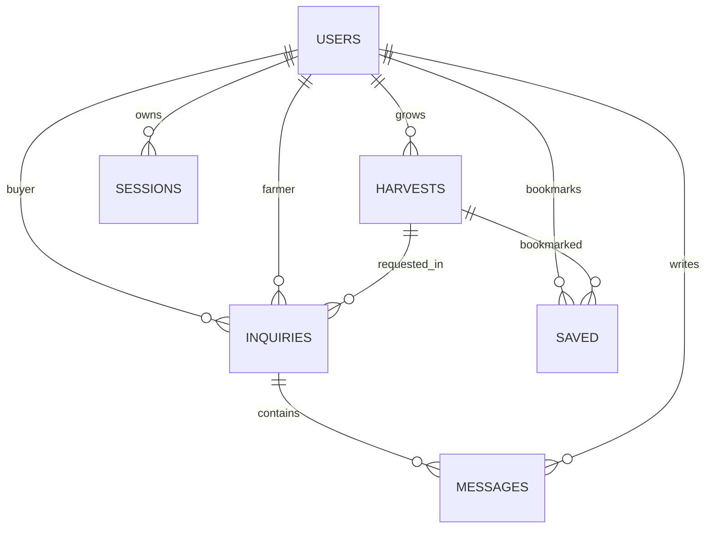

# Database and Layered Architecture

## Request lifecycle

```text
Browser: HTML + editable CSS + js/app.js
      |
      | fetch('/api/...') JSON over HTTP
      v
ApiHandler.java (HTTP routes, status codes, session, role checks)
      |
      v
Service contracts: AuthService / MarketplaceService / TradeService
      |
      v
Default*Service (validation and business rules)
      |
      v
Repository contracts: AccountRepository / HarvestRepository / TradeRepository
      |
      v
Jdbc*Repository (prepared SQL queries, transactions)
      |
      v
Database.java -> embedded HSQLDB persisted in data/farmlink.*
```

## Entity relationships



Tables: `users`, `harvests`, `inquiries`, `messages`, `saved`, `sessions`. Foreign keys protect references. Harvest unlisting changes `status` to `inactive` rather than deleting records associated with existing inquiries.

## Database setup

- **Engine**: HSQLDB embedded (bundled at `lib/hsqldb.jar`), no database administrator or external server.
- **Database directory**: `data/` in the project root. Data remains after the Java server stops and restarts.
- **Schema**: `Database.java` checks which tables exist and creates missing ones. The human-readable reference is `database/schema.sql`.
- **Demo data**: On first start, `DemoSeeder.java` creates one farmer, one buyer, nine harvests, two saved items, one request and its first message. Set `FARMLINK_SEED_DEMO=false` to disable new demo seeding before first startup.
- **Reset**: Stop the server, back up your database if needed, and delete `data/farmlink.*`. Restart to create fresh tables. Never delete those files while the app is running.
- **Backups**: Stop the server and copy the whole `data/` directory, not only one `.script` file.

## Why interfaces?

The `DefaultTradeService` constructor receives `TradeRepository` and `HarvestRepository` instead of directly using SQL. This is dependency injection. To use a different database, you can add a new repository implementation without rewriting the controller or browser code.

## Security and transactional checks

- Salted PBKDF2-SHA256 password hashing (150,000 iterations).
- Random opaque 7-day session cookies; the server stores only the SHA-256 digest of a session token.
- `HttpOnly` and `SameSite=Lax` cookie flags. The server checks browser `Origin` on writes.
- SQL prepared statements and strictly validated IDs, quantities, image formats, text lengths and enum values.
- Farmer-only listing edits, buyer-only favourites and requests, private farmer/buyer conversations.
- Stock is reserved on acceptance and released when an accepted request is cancelled using an SQL transaction. A conditional `UPDATE` prevents acceptance beyond available quantity.
- HTML escaping before inserting dynamic text into the frontend.

**Production notes**: A public deployment still requires HTTPS with `Secure` cookies, a proper reverse proxy and deployment checks, rate limiting, password reset, account verification, backups, monitoring, and ideally a modern database engine and automated security review. There are no credit card/payment integrations.
