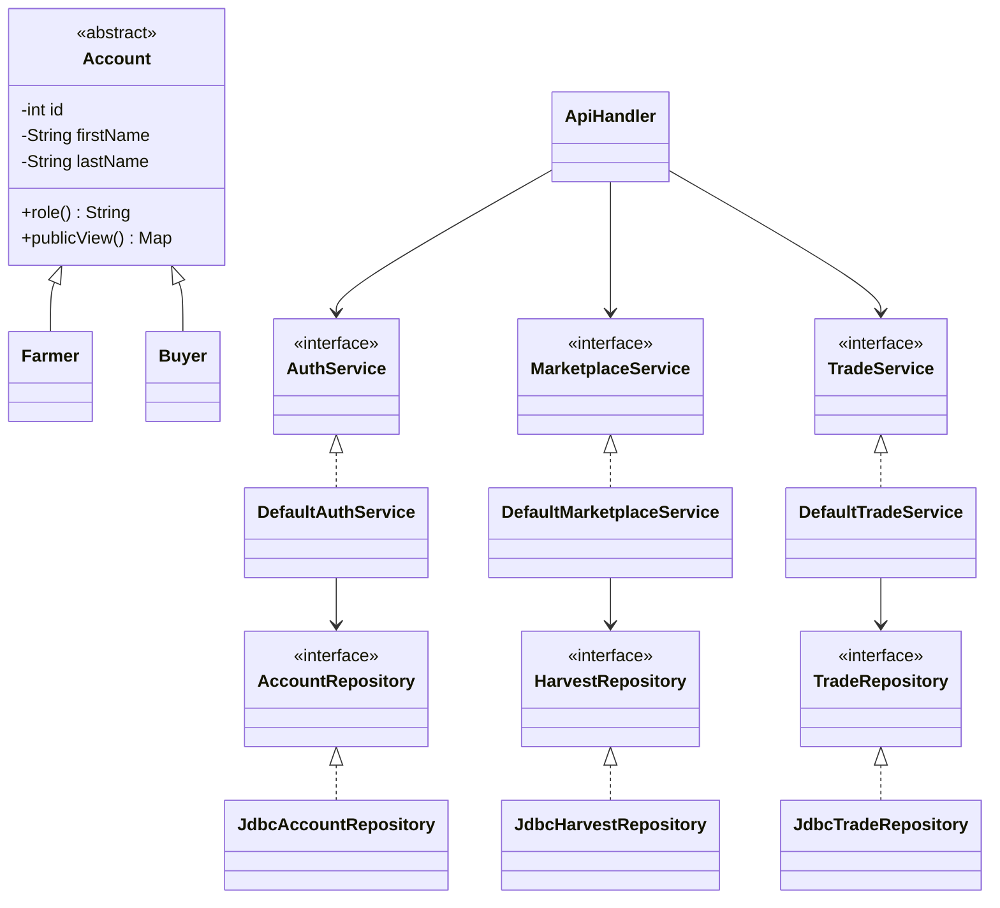

# FarmLink — All Four Java OOP Concepts (Code Reference)

This guide maps **real classes in the project** to the four Object-Oriented Programming concepts. The examples are taken from the working Java sources rather than being unrelated textbook snippets. All source files live in `src/main/java/com/farmlink/`.

## 1. Encapsulation — protect internal state

**Files:** `Account.java`, `Harvest.java`, `PasswordHasher.java`

`Harvest` keeps its data private and final. External code cannot assign to a harvest's price, farmer ID, or status. To modify a persisted harvest, callers use the validated `MarketplaceService` interface instead of writing fields directly.

```java
public final class Harvest {
    private final int id, farmerId;
    private final double price, quantity;

    public int id() { return id; }
    public int farmerId() { return farmerId; }
    public double price() { return price; }
    public double quantity() { return quantity; }
}
```

`Account` also uses `private final` fields and controlled getters. `PasswordHasher` never exposes the raw password to the database; `DefaultAuthService` writes a salt + PBKDF2 hash.

**Why it matters:** Other classes cannot bypass the validation and ownership checks by changing object fields directly.

## 2. Abstraction — define what something can do, hide how it works

**Files:** `Account.java`, `AuthService.java`, `MarketplaceService.java`, `TradeService.java`, `AccountRepository.java`, `HarvestRepository.java`, `TradeRepository.java`

The abstract `Account` represents shared information about a person without claiming that every account has the same role:

```java
public abstract class Account {
    // Shared, private account details and getters.
    public abstract String role();
    public Map<String, Object> publicView() { /* ... */ }
}
```

Java interfaces define **contracts** for each layer. Example:

```java
public interface MarketplaceService {
    List<Map<String, Object>> browse(Map<String, String> filters) throws SQLException;
    Map<String, Object> create(Account user, Map<String, Object> data) throws SQLException;
    Map<String, Object> update(Account user, int id, Map<String, Object> data) throws SQLException;
    void unlist(Account user, int id) throws SQLException;
}
```

The API controller only knows the interface. The actual persistence technology is hidden behind repositories, so a future MySQL or PostgreSQL version can implement the same contract.

**Why it matters:** The frontend, API, business rules and database details are separated.

## 3. Inheritance — reuse common fields and behavior

**Files:** `Farmer.java`, `Buyer.java`, `Account.java`

Both concrete user types inherit the shared identity and public profile behavior:

```java
public final class Farmer extends Account {
    public Farmer(int id, String first, String last, String nic,
                  String email, String phone, String district,
                  String province, String address) {
        super(id, first, last, nic, email, phone, district, province, address);
    }
    @Override public String role() { return "FARMER"; }
}

public final class Buyer extends Account {
    // Same constructor delegates common fields to Account.
    @Override public String role() { return "BUYER"; }
}
```

**Why it matters:** Profile fields and methods are defined once in `Account`. We don't need to duplicate them across the two user roles.

## 4. Polymorphism — same operation, different result

**Files:** `Account.java`, `Farmer.java`, `Buyer.java`, `JdbcAccountRepository.java`, `DefaultTradeService.java`

A variable of type `Account` can refer to either a `Farmer` or a `Buyer`. Java invokes the correct overridden method at runtime.

```java
Account user = accountRepository.find(userId);
System.out.println(user.role()); // "FARMER" or "BUYER", depending on subtype
```

`Account.publicView()` calls `role()` — the value depends on the actual subclass even though the method belongs to the base class. The controller does not need to downcast the account.

Interface polymorphism also appears at startup:

```java
AccountRepository users = new JdbcAccountRepository(db);
MarketplaceService market = new DefaultMarketplaceService(harvests);
TradeService trade = new DefaultTradeService(tradeRepo, harvests);
```

The variables depend on **interfaces**, not concrete implementation types. A different implementation can be swapped in later without changing API controller method signatures.

**Why it matters:** The code is easier to extend, test and maintain.

## The full OOP picture



## Where to look when presenting this to your lecturer

| Concept | Class to open | Code to explain |
|---|---|---|
| Encapsulation | `Harvest.java` | `private final` fields + safe getter methods |
| Abstraction | `Account.java` / `MarketplaceService.java` | `abstract` class and service interface |
| Inheritance | `Farmer.java` / `Buyer.java` | `extends Account`, `super(...)` |
| Polymorphism | `JdbcAccountRepository.java` / `Main.java` | `Account` subtype creation, interface variable assigned an implementation |
| Repository pattern | `HarvestRepository.java` | Controller does not directly run SQL |
| Dependency inversion | `Main.java` | Assemble interfaces and implementations at application startup |
| Dependency injection (manual) | `DefaultTradeService.java` | Services receive their required repositories through constructors |

**Flow to demonstrate:** Buyer sends a request → `ApiHandler` calls `TradeService` → `DefaultTradeService` checks the user's role and stock → `TradeRepository` persists the request → frontend updates from JSON API response.
